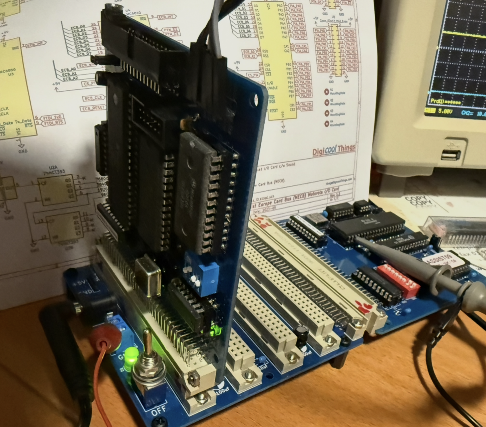
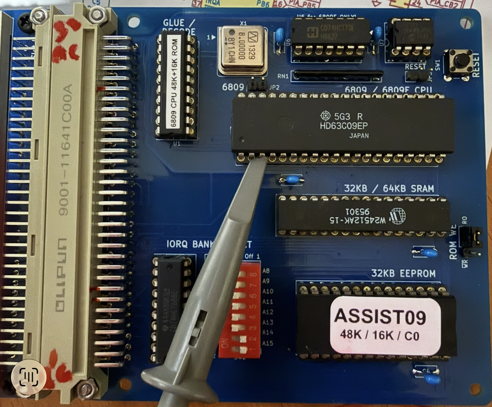
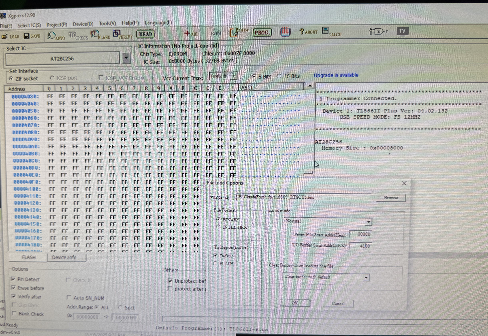
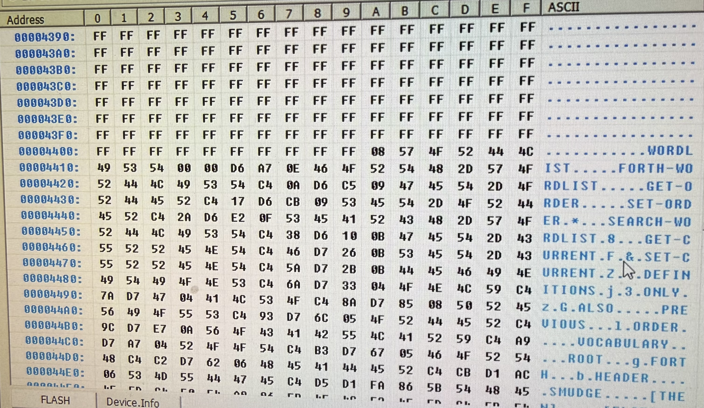
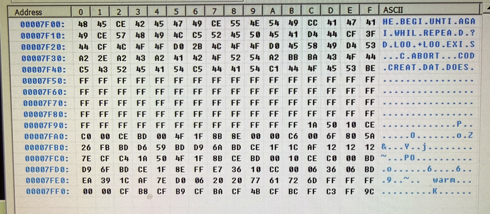
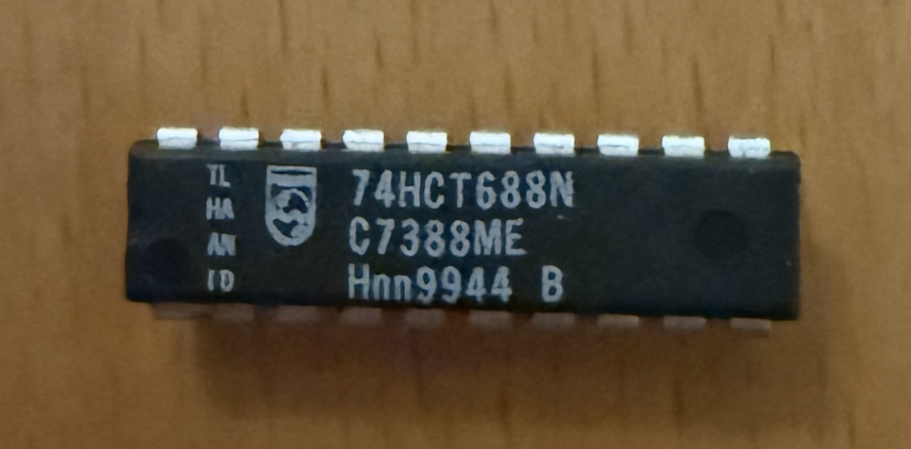
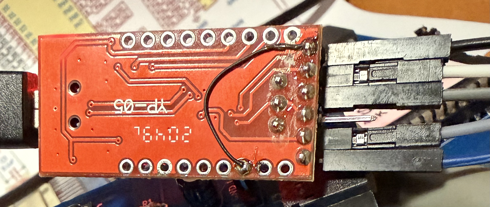
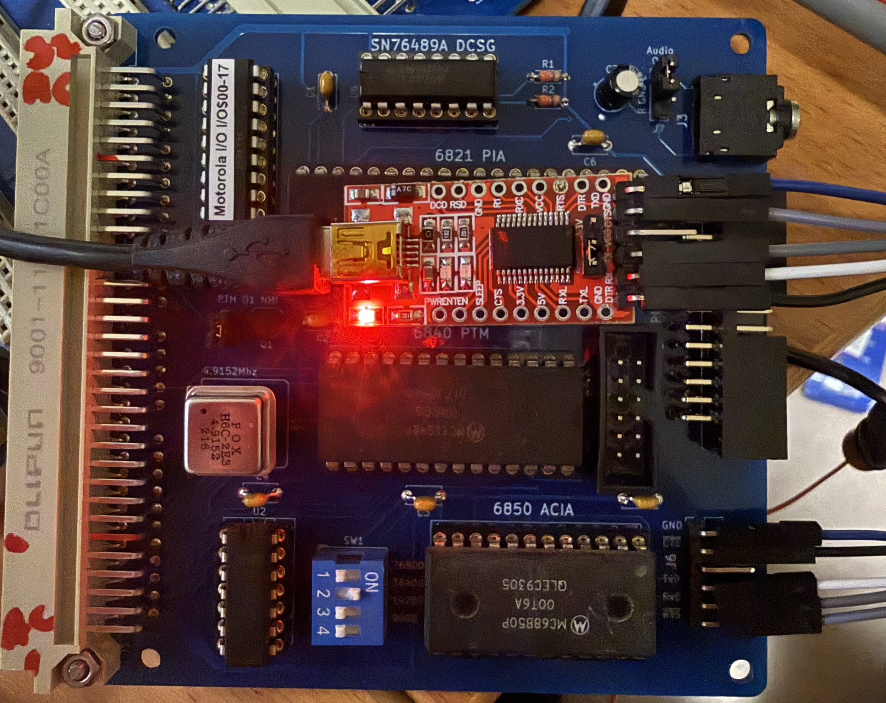

# MECB 6809 Card Computer

## Introduction

ClaudeForth targets a computer with a Eurocard backplane,
a 2 MHz MC6809 CPU card and an IO card with an MC6821 PIA, MC6850 ACIA and MC6840 PTM. 
The CPU card is configured with a memory split of 48k/16k of RAM/ROM and
and an IO area at $C000, carving out $100 bytes from the bottom of the ROM area.
The IO card is located at the IO base address of $C000.

## CPU Card Configuration

The CPU card is version 2.5. 
The MC6809 CPU is the E version with external clock.
The crystal oscillator is 8 MHz divided by 4 to provide the system clock.
The CPU card address map is determined by the PLD programming 
and the DIP switches with the value set to $C (8 + 2 = 12).

The provided ROM with ASSIST09 was back-upped/reprogrammed 
with the ClaudeForth raw bin file using a XGecu Model: TL866 II plus.
AT28C256 is a $8000 (32k) ROM, but only the top $4000 (16k) is used.
The bin file content at zero offset corresponds to ROM address $C100. 
Therefore the setting for upload into the programming application 
is $0000 offset for the file, matching $4100 in the ROM buffer. 
The graphic shows how this is setup.  

The assembler list file can be used to check that 
the addresses as shown in the ROM buffer are correct as follows.

Beginning addresses showing forth dictionary:

End addresses showing the processor vectors:

The computer failed to boot. 
The failure was attributed to the 74HCT688 comparator chip.
This was diagnosed as bad with the chip tester in the TL866 II plus. 
It failed its test vectors.
Other samples in the same batch tested as fine, but still malfunctioned.
They were unable to pull down the input of the PLD when the address matched.

Installing a chip from an entirely different manufacture eliminated the fault.

## IO Card Configuration

A USB to serial dongle was connected to the serial card 
with signal associations as follows:

| IO Card | Dongle |
| ------- | ------ |
| Gnd     | Gnd    |
| RxD     | Tx     |
| TxD     | Rx     |
| CTS     | RTS    |
| RTS     | CTS    |

The dongle was modified to provide RTS instead of DTR.

The baud rate was set at the second highest; 38400. 
The highest baud rate provided by the card is unusual 
and rarely provided by host software.
In any case higher baud rates drop the occasional character,
even with RTS/CTS handshaking active.

## Host Serial Communications

The MacOS application "Serial" is able to recognise the USB dongle. 
In its default configuration of 38400 baud, 1 stop bit, no parity, hardware handshaking,
its able to communicate short lines, but locks up entirely on long lines.
Best I can tell, Serial is using pacing based on receiving character echo 
and this conflicts with the output buffering provided by the 
the ClaudeForth firmware.

Turning off character pacing solves the problem 
though a per-character delay of 20 ms or so 
is required to avoid corrupted characters.

The Serial problem does not exist when using the python based test runner,
as it uses compiler generated "ok"-based pacing.
